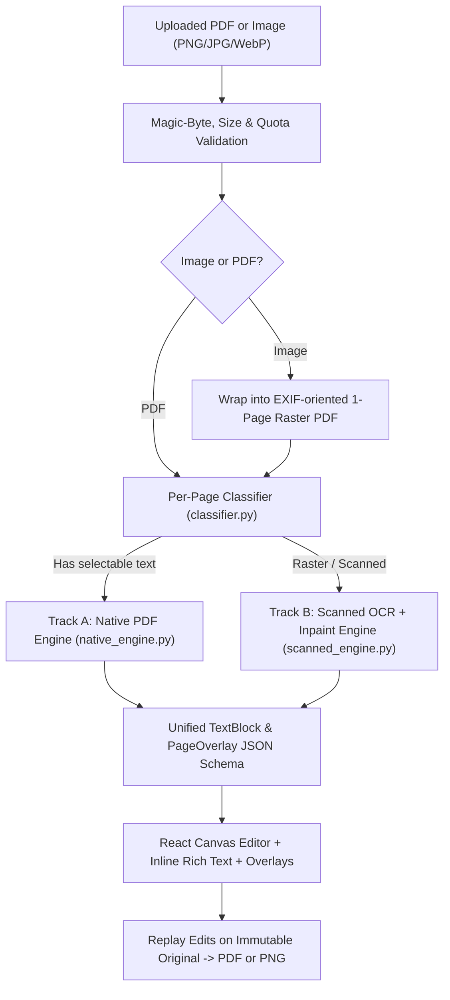

# Architecture Overview

`verso` splits document editing into clean, composable layers so both native vector PDFs and scanned/image files share one unified editor and export pipeline.

## Core Invariants

1. **Immutable Originals**: The uploaded PDF (or image-wrapped canonical PDF) is never mutated in place. Every preview and export replays `edits` + `overlays` cleanly from the original file so repeated edits never compound artifacts.
2. **Per-Page Classification**: Mixed PDFs (e.g., native cover letter + scanned signed annex) are classified page-by-page in `backend/src/editpdf/classifier.py`.
3. **Dual Persistence Parity**: `WorkspaceRepository` in `backend/src/editpdf/storage.py` provides identical behavior on both `SqliteWorkspaceRepository` (zero-setup local/self-hosted) and `AppwriteWorkspaceRepository` (cloud TablesDB + Storage with cursor pagination).

## Backend Modules (`backend/src/editpdf/`)

| Module | Responsibility |
| :--- | :--- |
| `api.py` | Thin FastAPI HTTP layer, CORS, security headers, guest cookie middleware, rate limits, CAPTCHA, optional SPA static mount |
| `service.py` | `SessionStore`: workspace orchestration, LRU RAM & disk cache eviction, OCR concurrency semaphore, quota enforcement |
| `classifier.py` | Per-page native vs. scanned classification |
| `native_engine.py` | Vector span extraction, embedded font `cmap` glyph checks (`fontTools`), metric fallback, background-sampled redaction & re-insertion |
| `scanned_engine.py` | `RapidOCR` word/line grouping, OpenCV Telea inpainting, ink color & scan-grain matching |
| `stamp_engine.py` | OpenCV pixel capture & background removal (`ink` flat-field LAB, `engraved` CLAHE+Sobel, `cutout` GrabCut) returning tintable RGBA mask PNGs |
| `overlays.py` | Renders whiteout shapes and rotated/cropped/semi-transparent image/signature/stamp overlays onto PDF pages |
| `fonts.py` | Embedded font extraction & metric-compatible system font lookup |
| `storage.py` | `SqliteWorkspaceRepository` and `AppwriteWorkspaceRepository` |
| `auth.py` | Appwrite JWT verification, HMAC per-browser guest cookies, HMAC short-lived asset URL signing, local dev tokens |
| `security.py` | Sliding-window rate limiter (with periodic key pruning), Turnstile verifier, magic-byte upload validators |
| `config.py` | Env-driven `Settings` dataclass + production startup validation guards |
| `models.py` | Strict Pydantic v2 request/response and overlay schemas |

## Frontend Architecture (`frontend/src/`)

| Path | Responsibility |
| :--- | :--- |
| `App.tsx` | Top-level router (`landing` / `dashboard` / `editor`), undo/redo history, auto-save, batch upload queue, lazy-loaded modals |
| `api.ts` | `apiFetch` wrapper with `credentials: "include"`, proactive 11-min Appwrite JWT refresh, 1-time 401 retry, `VITE_API_BASE_URL` |
| `lib/auth.ts` | Appwrite OAuth2 token flow, silent JWT refresh timer, sign-out |
| `lib/validation.ts` | Client-side magic-byte (`%PDF-`, PNG, JPEG, WebP) and file size validation before uploading any bytes |
| `lib/runs.ts` | Partial-run inline rich-text range styling & DOM syncing |
| `lib/stampRenderer.ts` | 60fps Canvas 2D government seal composer (circular/oval/box/raw, curved arc text, procedural rubber-ink distress) |
| `components/LandingPage.tsx` | Marketing landing page with upload-first hero |
| `components/DashboardPage.tsx` | Drive-style workspace: nested folders, drag-and-drop, right-click context menus, storage meter, shortcuts |
| `components/OverlayLayer.tsx` | Interactive drag/resize/rotate/crop overlay canvas |
| `components/StampStudioDialog.tsx` | Government Stamp Studio modal connecting `/api/stamps/extract` + `stampRenderer.ts` |
| `components/ImageLibraryDialog.tsx` | Image upload, "Open as stamp" launcher, and reusable saved library |
| `components/SignaturePadDialog.tsx` | Draw, type, and reuse saved signatures |
| `components/AuthDialog.tsx` | Social sign-in (dev test accounts strictly tree-shaken out of production builds) |
| `components/LegalDialog.tsx` | Privacy Policy & Terms of Service modal |
| `components/ErrorBoundary.tsx` | Top-level React error boundary |

## Security Model

- **Guest Isolation**: Anonymous users receive a signed `HttpOnly; SameSite=Lax` cookie (`verso_guest`) with a unique `gst_<random>` owner ID.
- **Private Assets**: `GET /api/assets/{asset_id}/content` requires either owner credentials or a valid short-lived HMAC `?exp=&sig=` token.
- **Production Guards**: `EDITPDF_ENV=production` refuses startup if `EDITPDF_ENABLE_DEV_AUTH=true`, `EDITPDF_AUTH_SECRET` is weak/default, or `EDITPDF_ALLOWED_ORIGINS` includes `*`.
