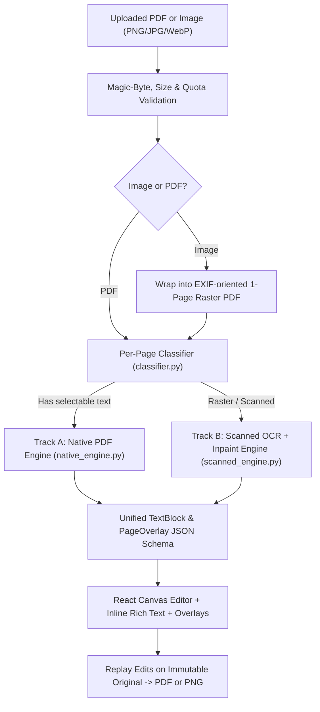
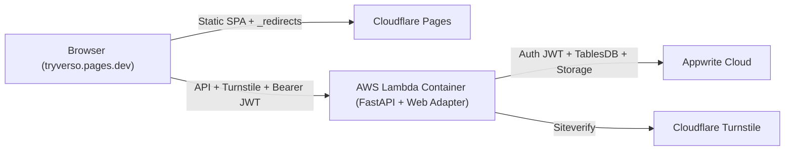

# Architecture Overview

`verso` splits document editing into composable layers so native vector PDFs, scanned PDFs, and raster images share one unified editor, persistence layer, and export pipeline.

## Production Topology

## Core Invariants

1. **Immutable Originals**: The uploaded PDF (or image-wrapped canonical PDF) is never mutated in place. Every preview and export replays `edits` + `overlays` cleanly from the original file so repeated edits never compound artifacts.
2. **Per-Page Classification**: Mixed PDFs (e.g. native cover letter + scanned signed annex) are classified page-by-page in `backend/src/editpdf/classifier.py`.
3. **Dual Persistence Parity**: `WorkspaceRepository` in `backend/src/editpdf/storage.py` provides identical behavior on both `SqliteWorkspaceRepository` (zero-setup local/self-hosted) and `AppwriteWorkspaceRepository` (cloud TablesDB + Storage with cursor pagination).
4. **Modular Frontend (< 300 LOC)**: Every `.ts`/`.tsx` file in `frontend/src/` is kept strictly under 300 lines with colocated local state, domain-scoped React 19 Contexts (zero prop drilling), and semantic Tailwind v4 `@theme inline` tokens in `frontend/src/styles.css`.

## Backend Modules (`backend/src/editpdf/`)

| Module | Responsibility |
| :--- | :--- |
| `api.py` | Thin FastAPI HTTP layer, CORS, security headers, guest cookie middleware, rate limits, CAPTCHA, root health route, optional SPA static mount |
| `service.py` | `SessionStore`: workspace orchestration, configurable `EDITPDF_SESSIONS_DIR`, LRU RAM & disk cache eviction, OCR concurrency semaphore, quota enforcement |
| `classifier.py` | Per-page native vs. scanned classification |
| `native_engine.py` | Vector span extraction, embedded font `cmap` glyph checks (`fontTools`), metric fallback, background-sampled redaction & re-insertion |
| `scanned_engine.py` | `RapidOCR` word/line grouping, OpenCV Telea inpainting, ink color & scan-grain matching |
| `stamp_engine.py` | OpenCV pixel capture & background removal (`ink` flat-field LAB, `engraved` CLAHE+Sobel, `cutout` GrabCut) returning tintable RGBA mask PNGs |
| `overlays.py` | Renders whiteout shapes and rotated/cropped/semi-transparent image/signature/stamp overlays onto PDF pages |
| `fonts.py` | Embedded font extraction & metric-compatible system font lookup |
| `storage.py` | `SqliteWorkspaceRepository` and `AppwriteWorkspaceRepository` |
| `auth.py` | Appwrite JWT verification, HMAC per-browser guest cookies, HMAC short-lived asset URL signing, local dev tokens |
| `security.py` | Sliding-window rate limiter (with periodic key pruning), Turnstile verifier, magic-byte upload validators |
| `config.py` | Env-driven `Settings` dataclass + production startup validation guards |
| `models.py` | Strict Pydantic v2 request/response and overlay schemas |

## Frontend Architecture (`frontend/src/`)

| Path | Responsibility |
| :--- | :--- |
| `App.tsx` | Thin auth-gated view router (`AppProviders` → `LandingPage` / protected `DashboardPage` / protected `EditorWorkspace`) |
| `app/AppProviders.tsx` | Composes `QueryClientProvider` (`@tanstack/react-query`), `TooltipProvider`, `WorkspaceProvider`, `EditorProvider`, and global `EditorModals` |
| `api/` (`client.ts`, `auth.ts`, `documents.ts`, `folders.ts`, `assets.ts`) | `apiFetch` with `credentials: "include"`, 11-min JWT auto-refresh, 401 single retry, AbortSignal support, and `VITE_API_BASE_URL` |
| `lib/queryClient.ts` | Shared TanStack Query `QueryClient` and typed `queryKeys` factory |
| `features/workspace/` | `context/WorkspaceContext`, `hooks/useWorkspaceQueries` + `useWorkspaceMutations` (TanStack Query), `utils/authGuard` |
| `features/editor/` | `context/EditorContext`, `hooks/` (TanStack Query `usePageLoader`, `useDocumentSession`, `useUploadFlow`, `useAssetPlacement`, plus actions & shortcuts), `components/` (`EditorWorkspace`, `EditorTopbar`, `EditorCanvas`, `InlineTextEditor`, `EditorInspectors`, `EditorModals`, `overlay-layer/`) |
| `features/dashboard/` | `context/DashboardContext`, `components/` (`DashboardSidebar`, `DashboardHeader`, `DashboardCanvas`, `FolderGrid`, `FileViews`, `DashboardContextMenu`, `DashboardModals`), `utils/selectors` |
| `features/landing/` | `components/` (`LandingHeader`, `LandingHero`, `LandingSections`, `LandingFooter`, `FeatureVisuals`, `primitives`) |
| `features/stamp/` & `lib/stamp/` | `context/StampStudioContext`, `hooks/useStampExtraction` (TanStack Query), `components/` + 60fps Canvas 2D seal renderer |
| `features/signature/` | `components/SignatureTabs`, `utils/renderSignature` |
| `lib/` (`auth.ts`, `validation.ts`, `runs/`, `format.ts`, `canvas.ts`) | Appwrite OAuth2 token flow, client magic-byte & size validation, inline rich-text run model & DOM sync |
| `components/ui/` & `styles.css` | shadcn/Radix primitives + semantic Tailwind v4 `@theme inline` tokens (zero raw hex classes) |

## Security Model

- **Protected Routes & Auth**: Dashboard and editor routes require authentication (`authGuard.ts`). Production uses Appwrite OAuth2 (Google / GitHub) with short-lived JWTs; local dev login is compiled out of production bundles and blocked by startup guards.
- **Cross-Site Cookie Hardening**: Guest cookies (`verso_guest`) use HMAC signatures with `HttpOnly`, configurable `EDITPDF_COOKIE_SECURE` and `EDITPDF_COOKIE_SAMESITE` (`none` + `secure` for split-origin deploys).
- **Private Assets**: `GET /api/assets/{asset_id}/content` requires owner credentials or a valid short-lived HMAC `?exp=&sig=` token.
- **Production Startup Guards**: `EDITPDF_ENV=production` refuses startup if `EDITPDF_ENABLE_DEV_AUTH=true`, `EDITPDF_AUTH_SECRET` is weak/default, `EDITPDF_ALLOWED_ORIGINS` includes `*`, or `EDITPDF_COOKIE_SAMESITE=none` without `EDITPDF_COOKIE_SECURE=true`.
